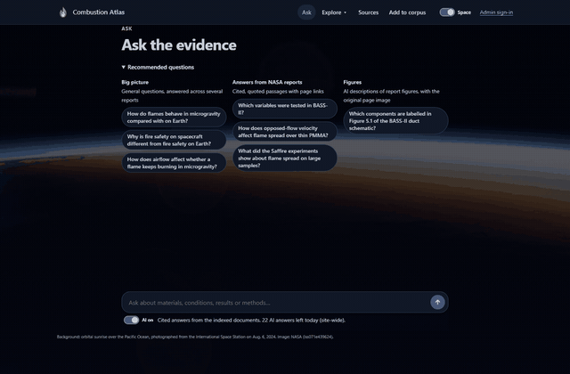
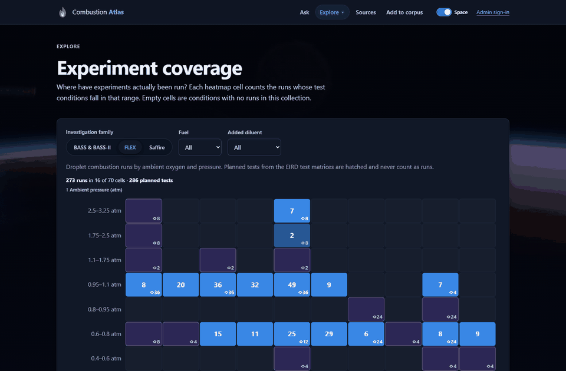
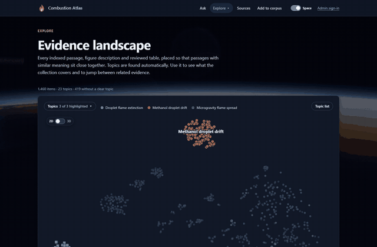

# Combustion Atlas

**Try it: https://combustion-atlas.azurewebsites.net**

Decades of NASA microgravity-combustion research, searchable and comparable, with every
answer quoting the original NASA page.

**Team Freefall Flame Lab:** David Yang and Sophie Lara. Built for the **NASA Space Apps
Challenge 2026**, challenge **"Flame in Freefall"**.

*Not an official NASA product.*

## The problem

Fire behaves differently in microgravity: without buoyancy, flames are rounder, slower and
can survive at lower oxygen than on Earth. NASA has run experiments on this for decades
(BASS, BASS-II, FLEX, Saffire), but the results are spread across data tables and long
technical reports with different formats and units. Before planning a new experiment,
a researcher has to dig through all of it to learn what has already been tested and what
was found. Combustion Atlas brings that evidence together, keeps every value tied to its
source, and shows where the evidence is thin.

## What it does

- **Ask:** a chat over 29 indexed NASA reports and PSI tables. Answers cite numbered
  footnotes that quote the source page word for word, and every quote and number is checked
  against the source before it is shown. Supports follow-up questions and figure browsing
  ("show me figures from BASS-II"). Turn AI off for a free keyword search. Typing two or more
  exact values returns the matching reviewed table rows with their notes, for example
  `13.6 oxygen 1.72 CO2` finds BASS-II tests O12 and O4.
- **Explore → Experiment coverage:** heatmaps of runs by test condition (for FLEX, ambient
  oxygen against pressure) that separate performed runs, tests only planned in NASA's test
  matrices, and conditions never tested, with a list of possible experimental gaps.
- **Explore → Evidence landscape:** a 2-D and rotatable 3-D topic map of every indexed
  passage, figure and table, with related evidence for each item.
- **Sources:** every document and experiment table, grouped by experiment, with links to the
  original NASA files. **Add to corpus** accepts PDF uploads, held for admin approval.
- **Fire in free fall:** an interactive explainer on the home page, using real NASA photos
  of candle flames on Earth and in microgravity.

| Ask with cited answers | Experiment coverage | Evidence landscape |
| --- | --- | --- |
|  |  |  |

**Presentation deck:** [`combustion_atlas_slides_final.pptx`](combustion_atlas_slides_final.pptx)

The raw NASA files (PDFs and PSI tables), the search index, figure images and credentials
are not stored in this repository; see [`docs/local_artifacts.md`](docs/local_artifacts.md).
The reviewed table records and table-extraction runs are (`data/processed/`). Architecture,
scientific review notes and operating instructions are in [`docs/`](docs/), and
[`docs/deploy_azure.md`](docs/deploy_azure.md) covers hosting.

## How it works

The evidence takes two paths:

- **Structured tables, with human review.** Each PSI experiment table is mapped to one run
  schema that keeps the raw cells, units and provenance. An AI model proposed the mappings and
  transcribed PDF tables; deterministic checks verify every number against the source; a
  person reviewed flagged values using recorded rules. Ambiguous values keep a visible note
  instead of a guessed number, and planned tests are never counted as results.
- **Retrieval-augmented generation (RAG) over reports.** Reports are split into page-bounded
  passages and indexed for keyword (SQLite FTS5) and embedding search. A question retrieves
  passages and reviewed table records, the model writes an answer that must quote them, and
  the server rejects any claim whose quote or numbers do not match the source.

**Tech stack.** Python 3.12 back end on FastAPI and Uvicorn, with Pydantic, pypdf,
pdfplumber, NumPy and scikit-learn (t-SNE and HDBSCAN for the landscape). SQLite holds the
search index, with vectors cached in memory. The front end is React and TypeScript built with
Vite, with charts drawn in SVG and canvas. It is hosted on Azure App Service, defined in
Terraform and deployed by GitHub Actions, which run ruff, mypy, pytest and Vitest on Linux
and Windows.

## NASA data used

- **NASA Physical Sciences Informatics (PSI)** repository, https://psi.nasa.gov: BASS
  (PSI-26), BASS-II (PSI-25), FLEX (PSI-69, including the test matrices in the FLEX
  requirements document, EIRD) and Saffire I–III (PSI-98, PSI-99, PSI-100).
- **NASA Technical Reports Server (NTRS)**, https://ntrs.nasa.gov: technical reports on
  these investigations, including the BASS-II Summary Report (NASA/TM-20210011385).
- **NASA images:** ISS photograph iss071e439624 (orbital sunrise, site background); NASA Glenn
  Research Center photo GRC-1998-C-00485 (candle flames in normal gravity and microgravity);
  ISS photograph ISS040-E-021546 (BASS-II experiment aboard the ISS).

## How we used AI

AI is used in two ways: inside the product, and to help us build it.

**In the product**
- **Answers (OpenAI gpt-6-luna):** written only from passages retrieved from the indexed
  NASA documents. Every claim must quote its source; our code checks each quote and number
  against the source text before showing it, and claims that fail are removed.
- **Backup answers (Azure OpenAI gpt-5-mini):** used only if OpenAI is unavailable, with
  the same checks.
- **Search (OpenAI text-embedding-3-small):** turns passages and questions into vectors for
  semantic search. For broad questions, gpt-6-luna suggests up to three extra search queries.
- **Figure descriptions (gpt-6-luna, vision):** the 392 report figures were described once,
  offline. The site labels these as AI descriptions and links each to its original page image.
- **Topic names (gpt-6-luna):** names the 23 topics on the evidence landscape from their
  keywords and example passages. The topics themselves are found by clustering (HDBSCAN),
  not by AI.

**In preparing the data**
- **Table extraction (gpt-6-luna):** an LLM produced candidate transcriptions of the NASA
  experiment tables (PSI tables and report tables), keeping each original cell and its
  location. A team member reviewed these candidates; the site marks which records are
  reviewed, and AI output is never presented as measured data.

**In building the project**
- We used an AI coding assistant (Claude Code, by Anthropic) to help write and test code,
  documentation and infrastructure, under our direction and review. The team chose the
  problem and the approach and made all scientific review decisions.

**Images.** No AI image, video or audio generators were used. Photos are NASA's (see above).
The flame logo and the illustrated flames are vector graphics drawn in code, written with the
help of the AI coding assistant.

## Third-party software and licenses

| Software | Use | License |
| --- | --- | --- |
| FastAPI, Uvicorn | Web API and server | MIT, BSD-3-Clause |
| Pydantic | Data validation | MIT |
| openai-python | OpenAI and Azure OpenAI client | Apache-2.0 |
| pypdf, pdfplumber | PDF text and table extraction | BSD-3-Clause, MIT |
| NumPy, scikit-learn | Vector search, t-SNE, HDBSCAN | BSD-3-Clause |
| python-dotenv | Local configuration | BSD-3-Clause |
| React, React Router | Front end | MIT |
| Vite, Vitest | Front-end build and tests | MIT |
| TypeScript | Front-end language | Apache-2.0 |
| pytest, ruff, mypy | Python tests, lint, type checks | MIT |

Hosted services: OpenAI API (answers, embeddings, figure descriptions) and Microsoft Azure
(App Service hosting, Azure OpenAI backup). Combustion Atlas itself is released under the
[MIT License](LICENSE).

## Local setup

The reference environment uses Python 3.12 and [uv](https://docs.astral.sh/uv/). Once uv is installed:

```sh
uv sync --all-groups
cp .env.example .env
uv run pytest
```

Keep `.env` local. Use the data directories only for non-versioned captures and generated artifacts.

## Core commands

```sh
# Check the environment
uv run python -m combustion_atlas.setup

# Produce candidate JSON and the Markdown human-review queue
uv run python -m combustion_atlas.normalization data/raw/bass-ii.csv \
  --source-url https://psi.nasa.gov/physci/repo/data/investigations/PSI-25 \
  --investigation-id PSI-25 --test-ids B1 B2 B3 B4 B5 \
  --output data/review/psi-25-b1-b5.json

# Build page-preserving PDF chunks plus SQLite FTS5 search
uv run python -m combustion_atlas.rag build data/raw/report.pdf --investigation PSI-25

# Generate OpenAI embeddings for the indexed chunks
uv run python -m combustion_atlas.providers embed --allow-provider-calls

# Run hybrid keyword and dense retrieval
uv run python -m combustion_atlas.rag query "oxygen concentration and extinction" \
  --method hybrid --allow-provider-calls

# Build the React front end (Node 22), then launch the web app (FastAPI + Uvicorn)
(cd frontend && npm ci && npm run build)
uv run python -m combustion_atlas.app --port 8765
```

## Repository layout

```text
src/combustion_atlas/  Application package (FastAPI back end in app/api.py)
frontend/              React + TypeScript + Vite front end (built into app/web/)
tests/                 Unit tests and versioned fixtures
docs/                  Architecture, scientific review, and operating guidance
data/                  Local NASA captures, review, and retrieval artifacts (ignored)
```

## Evidence policy

NASA PSI/NTRS materials are the scientific source of truth. Normalization must preserve original cells, units, provenance, missing values, and ambiguity; it must never invent experimental values or turn instrument controls into physical measurements without documented calibration.
